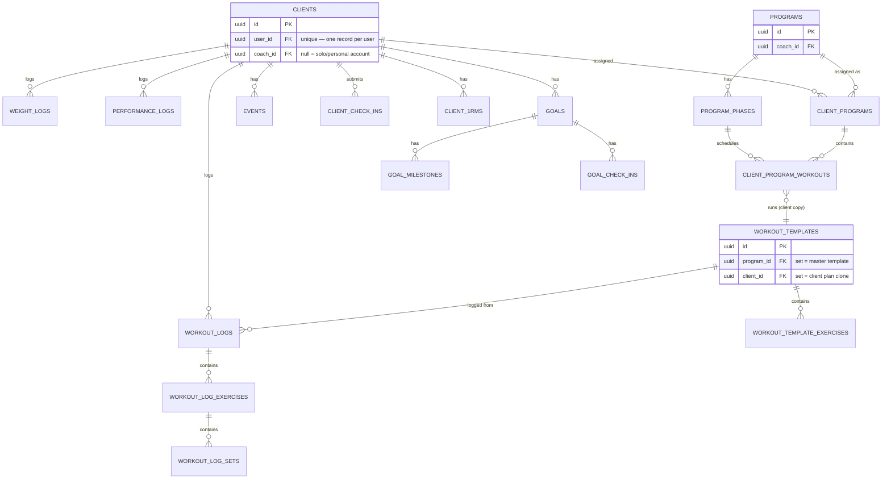
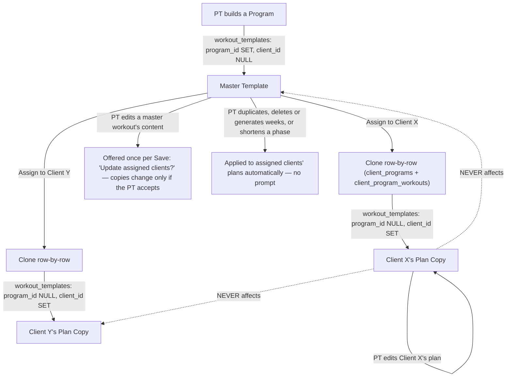
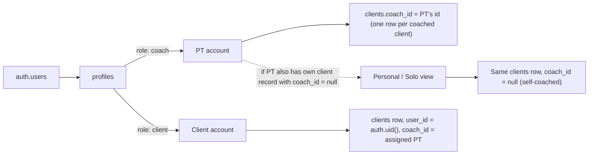
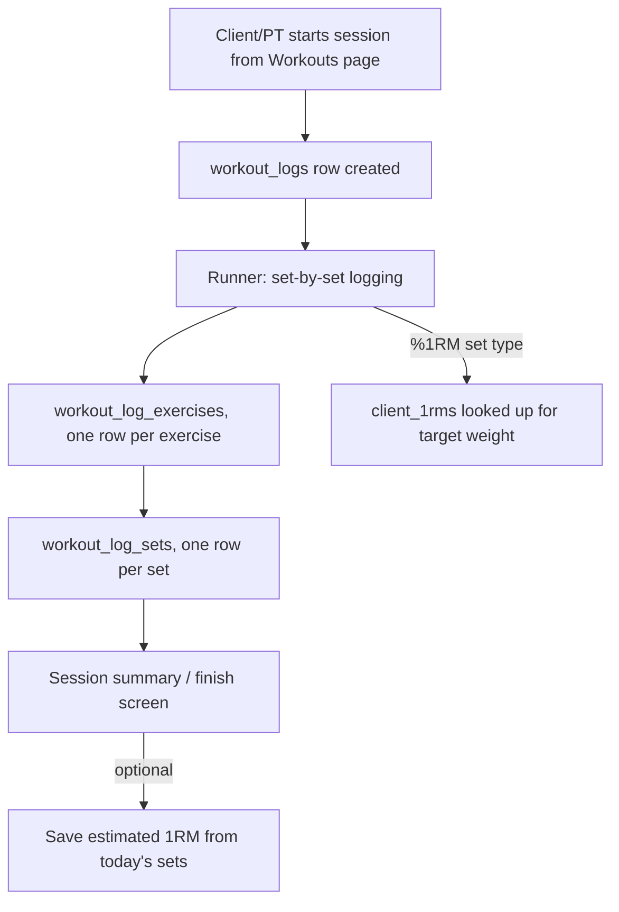

# Schema

Source: the Vault's `data-model.md`, migrated in full 2026-09-15. This is the canonical schema
reference — previously `architecture.md`/`technical-debt.md`/`handover.md` all flagged "no
canonical schema exists," which was true of the repo but not of the Vault. That gap is closed now.

The source of truth for actual live constraints is still Supabase itself (`information_schema`),
not this file — this is the design reference, kept in sync manually. Any schema change (new table,
new FK, renamed column) should update this file in the same commit as the migration, per
[decisions.md](decisions.md)'s documentation-maintenance rule.

## Core entity relationships

## The two-level editing model (the part that matters most)

The single highest-risk area in the schema — getting it wrong means one client's edit silently
changes another client's plan, or vice versa.

**Corrected 2026-09-20** (read from `js/app-programs.js` / `js/app-workouts.js`, not run): the diagram used to
say master edits reach *future* assignments only. A workout's content edit is offered to assigned clients once per
Save (`_checkClientPlanPropagation`); week-structure edits (`duplicatePhaseWeek`, `generatePhasePeriodization`,
`deletePhaseWeek`, shortening a phase) rewrite assigned clients' plans automatically. Whether that mix is
intended is Jake's call.

**Rule:** `program_id` set + `client_id` null = master. `program_id` null + `client_id` set =
personal copy. Never both set, never both null for a real template (standalone templates are both
null). No auto-renaming — template names only change manually, which is what lets "apply to all
sessions named X" work reliably.

**A third state exists and is not covered by the rule above** (per the 2026-08-12 architecture
audit, `docs/archive/architecture-audit-2026-08-12.md`): `generated_from_phase_id` set, with both
`program_id`/`client_id` null — a periodization-generated week-clone. Depended on directly by
`generatePhasePeriodization`/`_refreshProgramTemplates` in `app-programs.js`. Not independently
re-verified in this migration; flagged as a known doc gap in the source itself, carried forward
rather than silently patched.

**"No auto-renaming" also has an undocumented carve-out** (same audit): periodization week-clones
ARE auto-renamed with a `— W{n}` suffix, stripped for display in 3 places — verified by that audit
as intentional and load-bearing, not a bug.

## Account types / roles

**Key facts:**
- `clients.user_id` has a unique constraint — exactly one client record per user, ever.
- Solo/Personal is **not** a separate record — it's the same client record with `coach_id` nulled.
- `window._masterAccount` = true when the logged-in coach also has any client record (coached or
  personal).
- RLS anchor for solo: `client_id in (select id from clients where user_id = auth.uid() and coach_id is null)`.

## Workout logging flow (runner)

**Two corrections to this diagram, per the 2026-08-12 audit** (not independently re-verified here):
the `workout_logs` row is only created at **save** time, not session start — the runner is
localStorage-only until then, by the runner module's own header comment. And "Save estimated 1RM"
is fully shipped (`showPostSessionOneRMModal` et al.), not planned/dashed as the original diagram
marked it.

## Schema changes 2026-07-12 → 2026-08-24

Archived verbatim on 2026-11-10: [archive/schema-changes-2026-07-12-to-2026-08-24.md](archive/schema-changes-2026-07-12-to-2026-08-24.md). [architecture.md](architecture.md) lists the migration files.

## How to keep this in sync

- Any schema change (new table, new FK, renamed column) → update this file in the same commit as
  the migration.
- The source of truth for actual constraints is Supabase itself (`information_schema`) and
  [critical.md](critical.md), not this file — this is the design reference.
- Don't duplicate this elsewhere — one file.
- `types/database.d.ts` is generated, never hand-written (first generated 2026-10-29; it needs Jake's
  Supabase login, `npx.cmd supabase login`). Regenerate it in the same commit as any schema change, from
  PowerShell in the repo folder (`npx.cmd`, because PowerShell blocks `npx.ps1`; `Out-File -Encoding utf8`,
  because PowerShell 5.1's `>` writes UTF-16):
  `npx.cmd supabase gen types typescript --project-id avilxuiacmtgeoxxhfhc | Out-File -Encoding utf8 types/database.d.ts`.
  A NEW column shows up as a type error until regenerated, which is safe. A DROPPED column keeps
  type-checking against the stale file, which is not.

**goals.linked_metric, goals.linked_exercise_id** (2026-11-08): a goal that follows body weight or a lift. Progress is derived when read, never stored; see scripts/add-goal-links-2026-11-08.sql.

## Requires Validation

- This file was reconciled against migrations through 2026-08-24 in its original Vault form; this
  migration pass added the newer columns/tables already documented in `architecture.md`
  (`workout_templates.updated_at`, `workout_logs.template_id`) but did **not** independently
  re-verify every table/column against a live `information_schema` query — that's still owed.
- The third template-ownership state (`generated_from_phase_id`) and the periodization auto-rename
  carve-out are carried from the 2026-08-12 audit, not independently re-checked against current code.
- The two runner-flow diagram corrections above are likewise carried from that audit, not re-verified.
